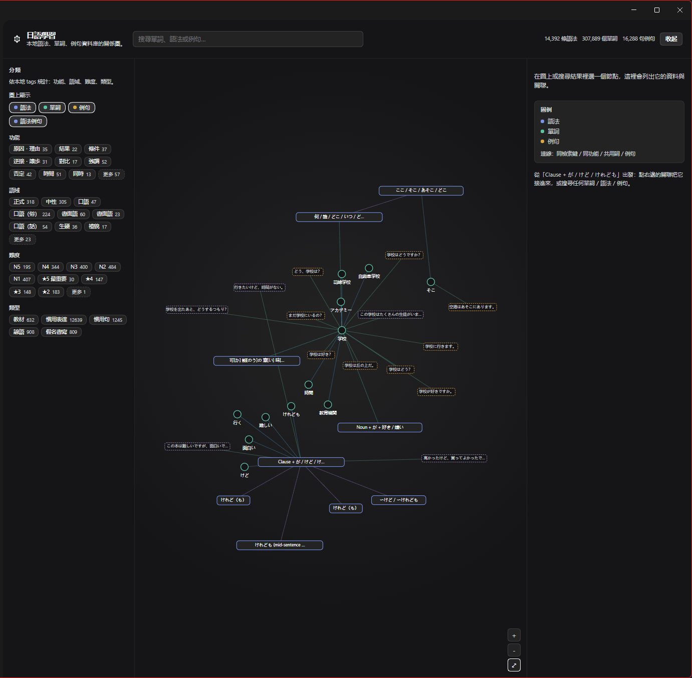
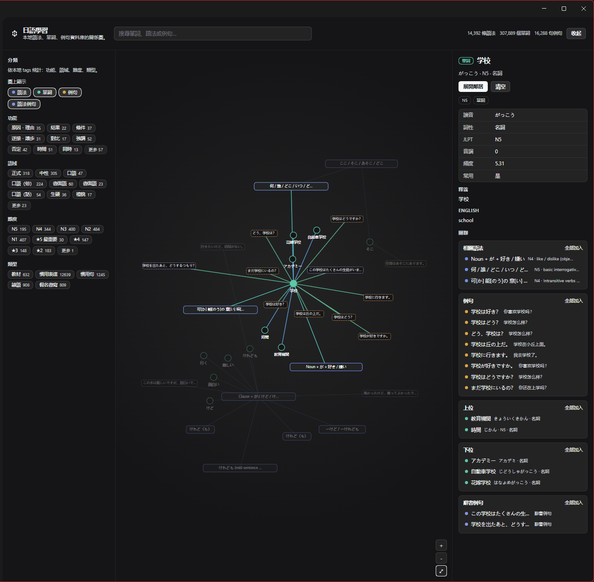

# @local/jp-graph · 日語學習

左側欄「日語學習」入口 + 一整頁關係圖，把本工作區的語法、單詞、例句資料庫畫成可互動的網路。

## 怎麼用

1. 點左側欄的 **日語學習**（在「研究台」下面）。
2. 首頁先給你一條語法與它全部的關聯：三句例句、四條同檢索鍵的近義語法、五個構成詞。
3. 頂部搜尋任何單詞／語法／例句（日文、中文釋義、英文都行），按 Enter 或點結果，就把它接進圖並選中。
4. 右邊列出選中節點的資料與分組關聯；點關聯裡的任一項，就把那個節點接進來（「全部加入」拉整組）。
5. 左邊「分類」把資料庫的 tags 統計成功能／語域／難度／類型，點一個標籤就把整組語法排成格子。

## 連線的來源

| 連線 | 來源 |
|---|---|
| 語法 → 例句 | `examples.id` = `grammar.id`，或 `grammar.json` 條目自帶的例句 |
| 語法 → 同檢索鍵語法 | `keys` 表：同一個檢索鍵指向不同條目（近義、對照） |
| 語法 → 同功能語法 | `grammar.tags` 的交集（只取「功能」面向，不含語域／難度） |
| 語法 → 構成詞 | 檢索鍵剛好是詞典詞、以及例句分詞後的高頻實詞 |
| 單詞 → 語法 | 檢索鍵命中、語法句型本身含這個詞、含這個詞的例句中實際出現的語法 |
| 單詞 → 例句 | `sentences`（Tatoeba，16k 條，帶中文） |
| 單詞 → 近義／反義／上位／下位 | 日本語WordNet（`wn_rel` / `wn_word`） |
| 例句 → 語法 | 工作區既有的比對器 `ja_lookup.GrammarDB.match`，與 skill 同一套規則 |
| 例句 → 單詞／例句 | Sudachi 分詞後查詞典；共用兩個實詞的句子 |

## 結構

- **Host**：[index.js](index.js) 註冊 `/jp-graph/api`，把查詢轉給常駐的 `scripts/jgraph.py --serve`（一行一個 JSON，結果有短期快取；首頁與分類不快取）。
- **Client**：[client.js](client.js) 註冊 `sidebar.panellist`（id `jp-graph`）與 `main`（key `jp-graph`）：力導向圖、分類面向、節點資料面板，樣式全部走 DSH 主題變數。
- **引擎**：[scripts/jgraph.py](../../scripts/jgraph.py)，只讀 SQLite（`mode=ro`），複用 `ja_lookup` 的 `GrammarDB` 與 Sudachi 分詞。

## 安裝

DSH → 插件 → 添加插件 → 選這個目錄；或由 Agent 用 `plugin_manager` 的 `install_bundle` 指向這裡。需要工作區的 `.venv`（Sudachi、`ja_lookup.py`）。

資料來源與限制見 [docs/DETAIL.zh.md](docs/DETAIL.zh.md)。
