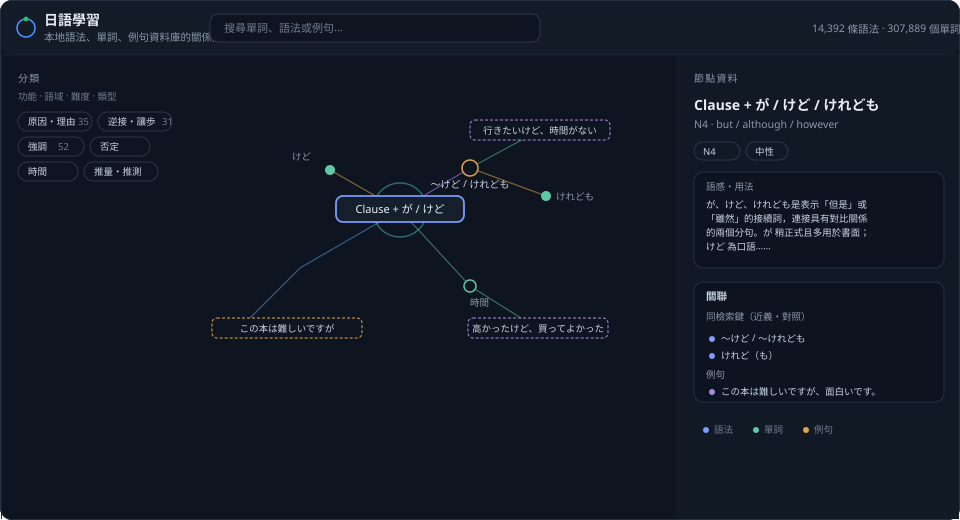

# Japanese study · knowledge map

The **Japanese study** entry in the left sidebar opens a graph over this workspace's local grammar, word and example databases. Three columns:

- **Classification** (left): stored tags grouped into function / register / level / type. Clicking a tag loads that group into the graph.
- **Graph** (centre): grammar = box, word = dot, example = dashed box. Click for data, double-click to expand its neighbours; drag nodes, drag the background to pan, scroll to zoom.
- **Node data** (right): formation, nuance, examples, tags and source, plus grouped connections — click an item to add it to the graph.

## Where the edges come from

Every edge is a relation stored in the data, not a model guess:

| Edge | Source |
|---|---|
| grammar → example | `examples.id` = `grammar.id`, or the entry's own examples in `grammar.json` |
| grammar → same-key grammar | `keys`: one lookup key pointing at different entries |
| grammar → same-function grammar | shared `grammar.tags` (function facets only) |
| grammar → component words | keys that are dictionary words, plus content words of its examples |
| word → grammar | key hits, patterns containing the word, and grammar actually matched in sentences containing the word |
| word → example | `sentences` (Tatoeba, 16k rows with Chinese) |
| word → synonym / antonym / hypernym / hyponym | Japanese WordNet (`wn_rel`, `wn_word`) |
| example → grammar | the workspace matcher `ja_lookup.GrammarDB.match` (same rules as the skill) |
| example → word | Sudachi tokens looked up in the dictionary |

## Search

Japanese (word / pattern / key / sentence text), Chinese glosses (the dictionary is simplified; traditional queries are converted once), and English glosses.

## Limitations

- Read-only: every connection uses `mode=ro` SQLite; no database or Anki data is changed.
- Edge quality is bounded by the data. WordNet occasionally produces odd hypernyms; they keep their relation label so you can judge them.
- Requires the workspace `.venv` (Sudachi, `ja_lookup.py`). Otherwise the panel reports that the engine is unreachable, with the reason.
- The engine runs as a long-lived `scripts/jgraph.py --serve` process beside the Host and stays idle while the panel is closed.
