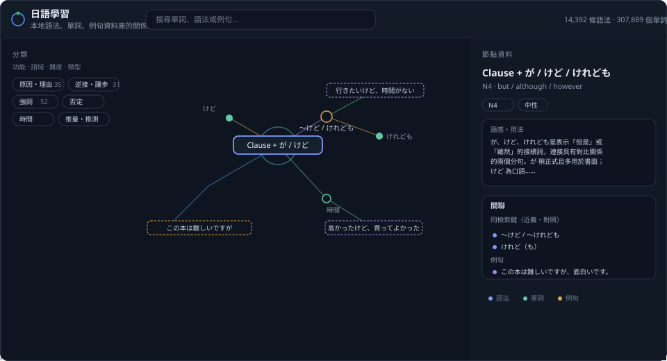

# 日語學習 · 知識圖譜

左側欄的「日語學習」入口打開這個工作區的日語資料關係圖。畫面分三欄：

- **左：分類**：把資料庫既有的 tags 統計成「功能 / 語域 / 難度 / 類型」四組，點一個標籤就把該組語法整批拉進圖裡（例如「逆接・讓歩」的 31 條）。
- **中：關係圖**：語法＝方框、單詞＝圓點、例句＝虛線框。點節點看資料，雙擊展開它的關聯；可以拖動節點、拖背景平移、滾輪縮放。
- **右：節點資料**：接續、語感、例句、標籤、來源，以及分組的關聯清單（點一項就把那個節點接進圖）。

## 連線的來源

圖上的每條線都對應資料庫裡真實存在的關聯，不是模型猜的：

| 連線 | 來源 |
|---|---|
| 語法 → 例句 | `examples.id` = `grammar.id`，或 `grammar.json` 條目自帶的例句 |
| 語法 → 同檢索鍵語法 | `keys` 表：同一個檢索鍵指向不同條目（近義、對照） |
| 語法 → 同功能語法 | `grammar.tags` 的交集（只取「功能」面向的標籤，不含語域／難度） |
| 語法 → 構成詞 | 檢索鍵剛好是詞典詞、以及例句分詞後的高頻實詞 |
| 單詞 → 語法 | 檢索鍵命中、語法句型本身含這個詞、以及含這個詞的例句中實際出現的語法 |
| 單詞 → 例句 | `sentences`（Tatoeba，16k 條，帶中文） |
| 單詞 → 近義／反義／上位／下位 | WordNet 日語（`wn_rel` / `wn_word`） |
| 例句 → 語法 | 用工作區既有的比對器 `ja_lookup.GrammarDB.match`，與 skill 同一套規則 |
| 例句 → 單詞 | Sudachi 分詞後查詞典 |
| 例句 → 同詞例句 | 共用兩個實詞的句子 |

## 搜尋

- 日文：單詞、語法句型、檢索鍵、例句全文
- 中文：詞典釋義（簡體資料庫，繁體查詢會自動轉一次）
- 英文：`meaning_en`、`gloss_en`

## 限制

- 只讀：所有查詢都走 `mode=ro` 的 SQLite 連線，不會改資料庫或 Anki。
- 關聯的品質受限於資料本身：WordNet 偶有噪音（例如「学校」的上位詞可能出現不相關的詞），它們照樣標著關係名稱顯示，方便你自行判斷。
- 需要工作區的 `.venv`（Sudachi 分詞、`ja_lookup.py`）。缺了會顯示「連不上日語資料引擎」與原因。
- 引擎常駐在 Host 程序旁（`scripts/jgraph.py --serve`），面板關掉後仍會留著待命。
